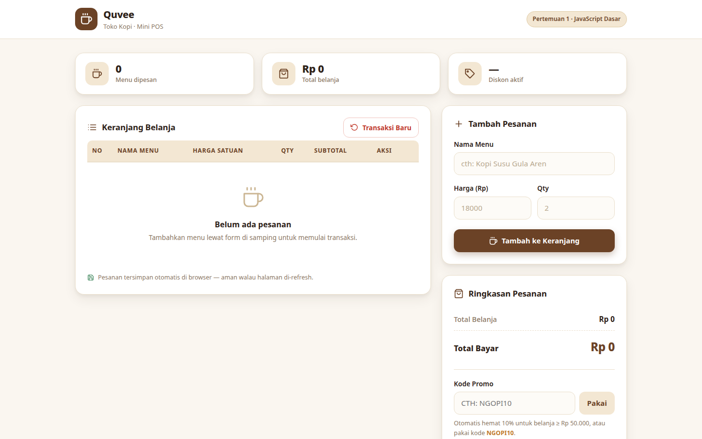
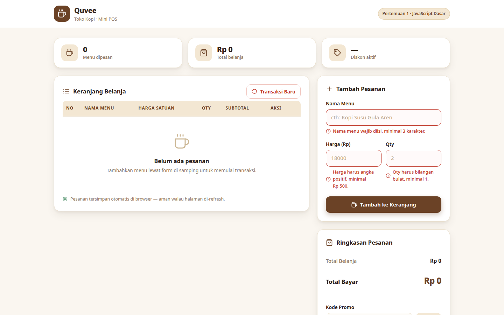
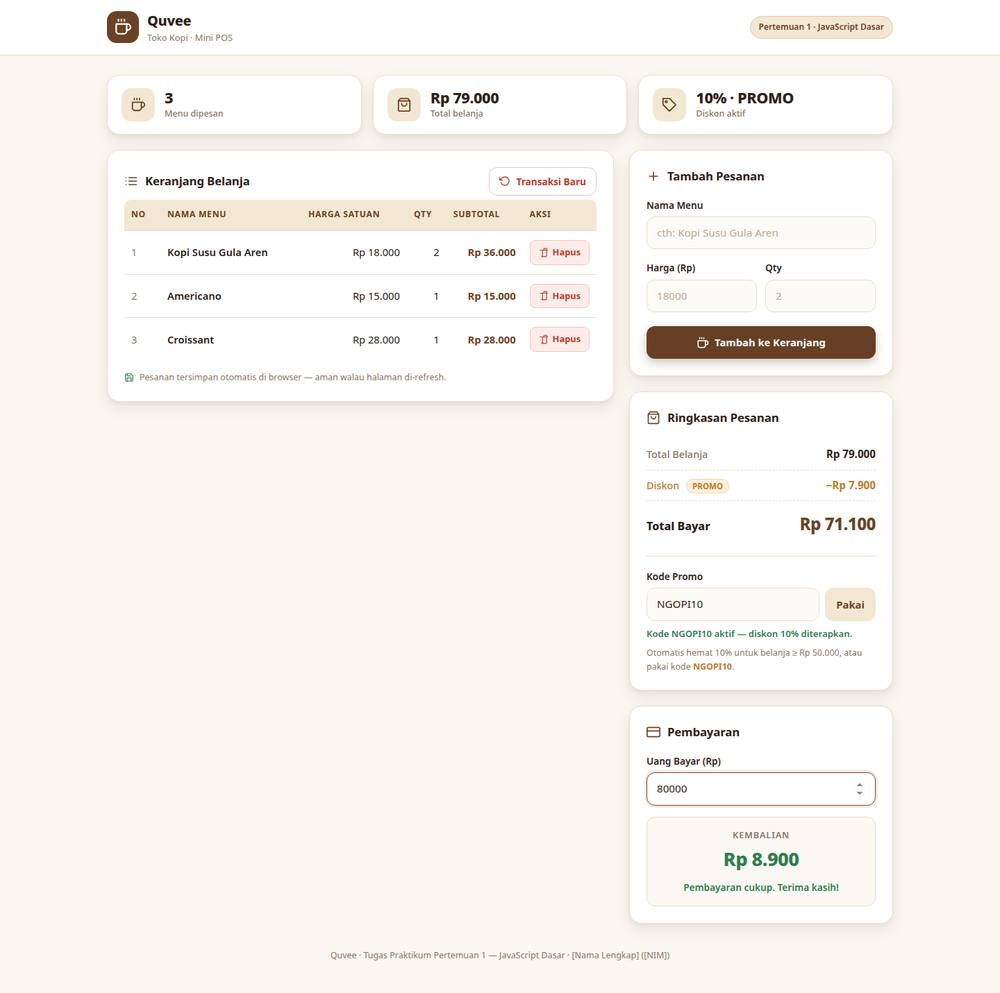

# Quvee — Mini POS Toko Kopi

## Identitas
- **Nama Lengkap:** Sahal alvin zairy
- **NIM:** 124140167
- **Kelas Praktikum:** [Kelas]
- **Pertemuan:** 1 — JavaScript Dasar

## Deskripsi Aplikasi
**Quvee** adalah aplikasi web Kasir & Keranjang Belanja Sederhana (Mini POS)
untuk toko kopi. Aplikasi ini dibuat untuk memenuhi tugas praktikum
Pertemuan 1 (JavaScript Dasar) dengan tujuan menyatukan tiga kompetensi
dasar: **validasi input form**, **perhitungan kalkulator otomatis**, dan
**manajemen keranjang belanja berbasis localStorage**.

**Studi kasus yang dipilih:** kasir toko kopi yang membutuhkan pencatatan
pesanan cepat — tambah menu, lihat total dan diskon otomatis, terima uang
bayar, hitung kembalian — dengan data pesanan yang tidak hilang saat halaman
di-refresh.

## Panduan Menjalankan
Tidak membutuhkan build tool, server, atau koneksi internet khusus.

1. Buka folder proyek ini.
2. **Cara 1 (termudah):** klik dua kali file `index.html` — aplikasi langsung
   terbuka di browser.
3. **Cara 2 (disarankan):** buka folder di VS Code, install ekstensi
   **Live Server**, lalu klik kanan `index.html` → *Open with Live Server*.

## Daftar Fitur
- [x] Validasi nama menu (wajib diisi, minimal 3 karakter)
- [x] Validasi harga satuan (angka positif, minimal Rp 500)
- [x] Validasi qty (bilangan bulat, minimal 1)
- [x] Pesan error merah di bawah input yang salah; pesanan invalid dicegah
      masuk keranjang; form otomatis di-reset saat berhasil
- [x] Subtotal otomatis per baris (harga × qty)
- [x] Total belanja otomatis (jumlah seluruh subtotal)
- [x] Diskon 10% otomatis saat total ≥ Rp 50.000
- [x] Kode promo `NGOPI10` (tidak menumpuk dengan diskon otomatis)
- [x] Tampilan nominal diskon dan total akhir bayar
- [x] Kalkulator kembalian otomatis (uang bayar − total akhir) +
      peringatan jika uang belum mencukupi
- [x] Tabel keranjang (No, Nama Menu, Harga, Qty, Subtotal, Aksi)
- [x] Tombol Hapus per baris + hitung ulang otomatis
- [x] Penyimpanan localStorage via `JSON.stringify()` / `JSON.parse()`
      (persisten saat refresh)
- [x] Tombol Transaksi Baru (kosongkan keranjang + bersihkan localStorage,
      dengan konfirmasi)

## Tangkapan Layar

### 1. Form input utama


### 2. Validasi error

Submit tanpa mengisi form menampilkan pesan error merah di bawah setiap input
yang tidak valid, dan pesanan dicegah masuk keranjang.

### 3. Hasil perhitungan kalkulator & tabel keranjang

Contoh pesanan 3 menu: total Rp 79.000 → diskon promo `NGOPI10` 10%
(Rp 7.900) → total bayar Rp 71.100 → uang bayar Rp 80.000 → kembalian
Rp 8.900.

## Struktur File
```
[NAMA]_124140167_pertemuan1/
├── index.html              # Struktur HTML aplikasi
├── style.css               # Styling CSS antarmuka (tema kopi, custom)
├── script.js               # Logika JavaScript
├── README.md               # Dokumentasi ini
├── screenshot-form.png     # Tangkapan layar: form input
├── screenshot-validasi.png # Tangkapan layar: validasi error
├── screenshot-hasil.jpg    # Tangkapan layar: hasil kalkulator & tabel
└── modul/                  # File latihan materi praktikum
    ├── index.html
    └── latihan.js
```

## Penjelasan Teknis Singkat

### Penanganan validasi input
Setiap field punya fungsi validator murni (`validasiNama`, `validasiHarga`,
`validasiQty`) yang mengembalikan boolean. Saat form di-submit, `tambahBarang`
menjalankan ketiganya; tiap kegagalan memanggil `tampilkanError` yang menulis
pesan ke elemen `<p class="error-msg">` di bawah input terkait dan memberi
class `input-invalid` (border merah). Jika ada satu saja yang gagal, fungsi
berhenti lebih awal (`return`) sehingga pesanan tidak masuk keranjang. Error
langsung hilang saat pengguna mengetik ulang (event `input`).

### Algoritma kalkulator
- `hitungSubtotal(item)` = `harga × qty` per baris.
- `hitungTotal()` = `reduce` seluruh subtotal.
- `hitungDiskon(total)`: jika kode promo aktif → 10%; selain itu jika total
  ≥ Rp 50.000 → 10%; selain itu 0. Kedua sumber **tidak menumpuk**.
- `hitungTotalAkhir()` = total − diskon.
- Kembalian dihitung ulang setiap ada input di "Uang Bayar":
  `kembalian = bayar − totalAkhir`; jika negatif, tampilkan selisih kurangnya
  sebagai peringatan.
- Semua angka diformat via `Intl.NumberFormat("id-ID", { style: "currency",
  currency: "IDR" })`.

### Mekanisme serialisasi localStorage
State keranjang adalah array of objects `{ id, nama, harga, qty }`. Setiap
mutasi (tambah/hapus/reset) memanggil `simpanKeranjang()` yang melakukan
`localStorage.setItem(kunci, JSON.stringify(keranjang))`. Saat halaman dimuat,
`muatKeranjang()` membaca dengan `JSON.parse()` di dalam `try/catch` dan
memvalidasi bentuk tiap item; jika data korup/tidak valid, fallback ke array
kosong agar aplikasi tidak crash. Setelah itu `renderSemua()` menggambar ulang
tabel, ringkasan, dan kembalian dari state.
